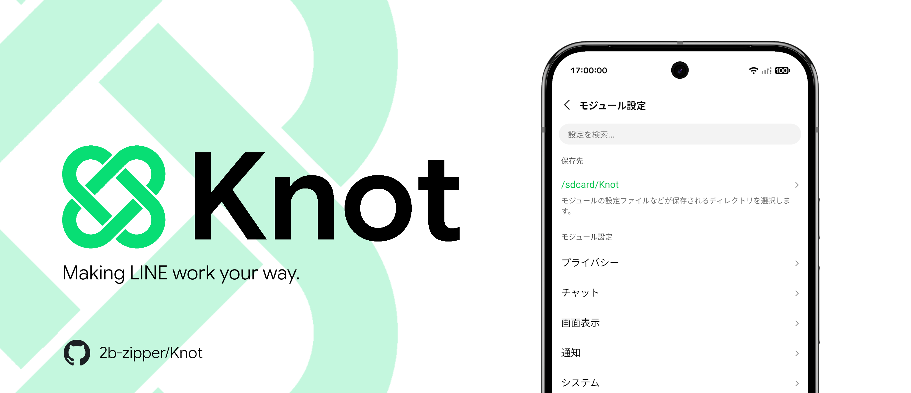
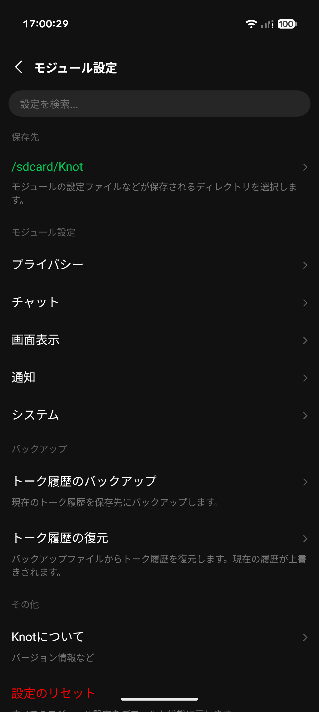
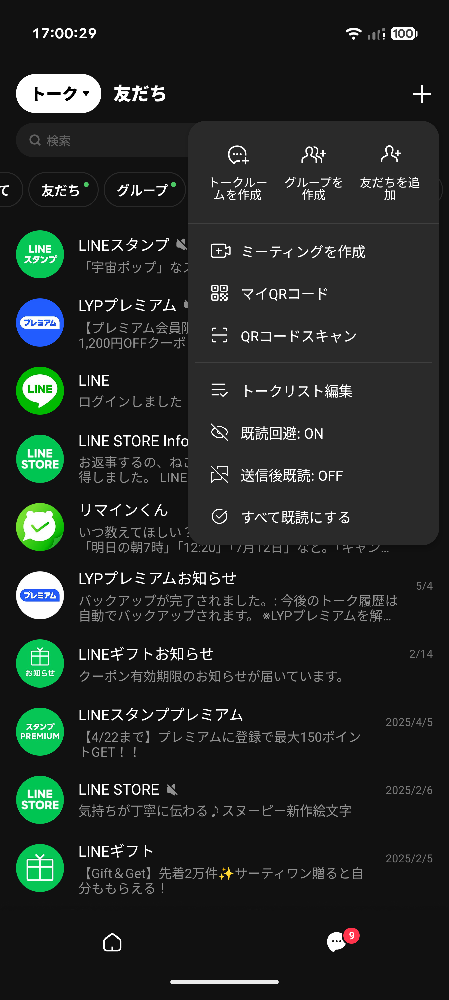
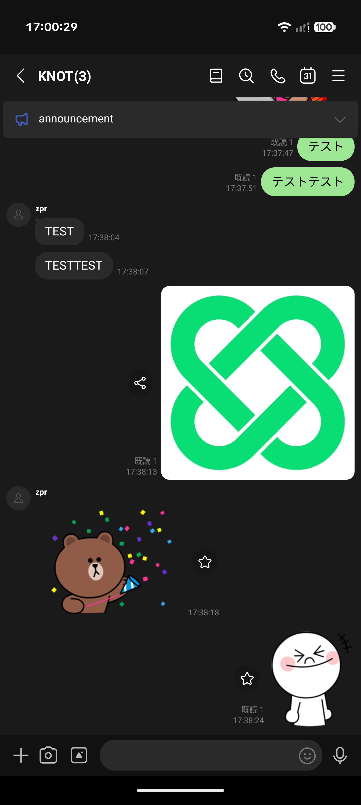
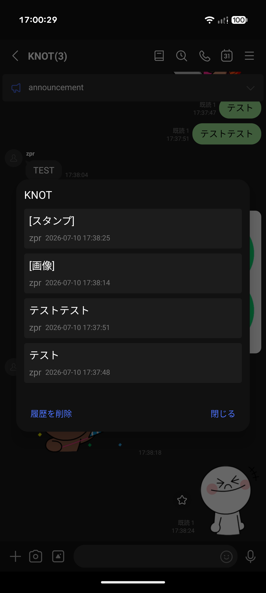
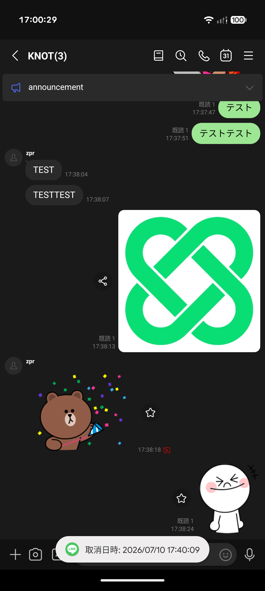
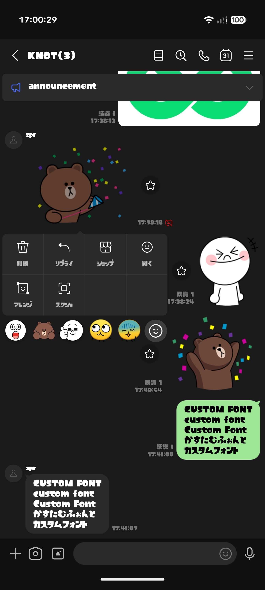

# Knot - Xposed module for LINE

[日本語](README.md) | **English** | [繁體中文](README.zh-Hant.md)

  
  
  
  
  

Knot is an Xposed module, currently in development, designed to improve the experience of using LINE on Android.

> ⚠️ This module is developed by individuals for educational purposes and is not affiliated with LY Corporation in any way. Using this module may violate LINE's Terms of Use, and the developers accept no responsibility for any disadvantage or damage resulting from its use, including account restrictions, suspension, or data loss. Use it at your own risk.

**Tested LINE versions**: 26.13.0, 26.13.1, 26.14.0, 26.15.0, 26.15.1, 26.16.0, 26.17.0, 26.17.1
(Other versions may also work, though some features might not.)

**Supported languages**: 日本語, English, 繁體中文

## Screenshots

  
  
  

  
  
  

## Features

See the [full feature list](https://knot.2ipper.com/#all-features) on the Knot website.

### Privacy
- **Read avoidance**: Keeps chats unread when you open them. Turn it on and off from the "+" menu, and optionally mark chats as read after sending or reacting.
- **Read history**: Records who read each message and when.
- **Scroll preview**: Re-enables scroll preview, which was removed from LINE Labs and is now exclusive to LYP Premium.
- **Classic long-press menu**: Shows only the menu, without the preview, when you long-press a chat in the chat list.
- **Edit history**: Saves the previous text of edited messages so you can view it from the long-press menu.
- **Permanent chat hiding**: Keeps hidden chats hidden even when new messages arrive.
- **Prevent unsend**: Keeps messages on your device even after the sender unsends them.
- **24-hour unsend limit**: Brings the unsend time limit back from one hour to 24 hours.
- **Profile update timestamps**: Shows when a friend was added, favorited, and last updated their profile, from their profile screen.

### Chat
- **Mute messages**: Re-enables mute messages, which were removed from LINE Labs and are now exclusive to LYP Premium.
- **High-quality photos & long videos**: Sends photos at maximum quality without automatic compression or resizing, and removes the 5-minute limit on video uploads.
- **Default camera & silent shutter**: Uses your device's default camera app instead of LINE's built-in camera, or silences the built-in camera's shutter sound.
- **Enhanced in-chat search**: Search only a specific member's messages and search with a single character, and toggle Search Keyword Assist with a button in the search bar.
- **Seconds in chat timestamps**: Adds seconds to the time shown next to each message (for example 12:34 → 12:34:56).
- **Select all in edit mode**: Adds a button to the message deletion screen that selects or deselects every message.
- **Open links in default browser**: Opens URLs in your system default browser instead of the in-app browser.
- **Hide AI icons**: Always hides Agent i in the message field, not just for 30 days.

### Appearance & UI
- **Ad removal**: Hides the ads shown at the top of the chat list, on the Home screen, and elsewhere.
- **Clean home tab**: Hides the recommended content, feed, and service list on the Home screen.
- **Tab customization**: Hides the News/Calls, Apps, Shopping, and Wallet tabs in the bottom bar, and can also hide tab labels or widen the tap area.
- **Clean chat header & plus menu**: Hides the "AI Friends", "OpenChat", "Calendar", and "Album" buttons at the top right of the Chats tab, and the "Agent i" button on every tab.
- **Custom fonts**: Applies the selected font file across the whole app.
- **Pure Black (AMOLED) theme**: Makes dark mode backgrounds pure black (#000000) and matches menus and dialogs to the same palette.
- **Themes on secondary devices**: Shows the "Themes" entry that LINE hides when you are signed in on a sub-device.

### Notifications & Calls
- **Reaction notifications**: Notifies you about reactions to your messages.
- **Stacked message notifications**: Groups up to seven messages in a single notification instead of replacing the previous one.
- **Notification media preview**: Previews images, video thumbnails, stickers, and emoji in message notifications.
- **Mark as read from notification**: Adds a button to message notifications that marks the chat as read and dismisses the notification.
- **Hide the "Mute" notification button**: Removes the "Mute" action button from LINE notifications.
- **Fix delayed or missing notifications (FCM Fix)**: Works around notifications not arriving on non-rooted devices (enabled by default on non-rooted devices).
- **Custom ringtones & ringback tones**: Replace the LINE call ringtone with any audio file, or play the default ringback tone instead of the song set by the person you call.

## Installation

  
  &nbsp;&nbsp;
  

### Rooted devices

1. Install an Xposed framework compatible with API 102, such as [Vector](https://github.com/JingMatrix/Vector/releases).
2. Install [Knot](https://github.com/2b-zipper/Knot/releases/latest) and enable the module in your manager.
3. Select LINE as the target app (module scope).
4. Restart LINE, then enable the features you want in Knot's module settings.
   * To open the module settings, long-press the settings button at the top right of the Home tab, or use the entry Knot adds to LINE's settings.

### Non-rooted devices
**!!! Be sure to back up your chat history before you start !!!**

#### 1. Preparation
1. Install the [forked version of NPatch](https://github.com/Nich87/NPatch).
2. Install [MicroG-RE](https://github.com/MorpheApp/MicroG-RE).
3. Open MicroG-RE and tap `Ignore optimizations` to turn off battery optimization. Then open `Self-Check` and grant all the permissions listed there.
4. Open `Accounts` in MicroG-RE and sign in with the Google account you used to back up your chat history.

#### 2. Patching and installing
5. Open NPatch, then grant it storage access and set the directory it will use.
6. Download and install the latest Knot from the release list on NPatch's home screen.
7. Tap the `Start Patch` button and choose a patching method.
   > `Download and Patch from Cloud Proxy` is recommended. If you download LINE yourself from APKMirror or a similar site, we recommend downloading and patching a version Knot has been tested on.
8. Select a LINE version or APK. On the `New Patch` screen, make sure `Force enable MicroG support` is turned on, then tap the `Start Patch` button at the bottom right to start patching.
9. When patching is done, tap the `Install` button at the bottom right to install it.
   > If Shizuku is installed, it is installed automatically.

#### 3. Initial setup and restoring your chat history
10. Launch LINE and log in. On the screen that asks you to choose a Google account for restoring your chat history, choose your account to restore it.
11. Tap the banner shown on LINE's Home screen to set the directory Knot will use, then long-press the settings button at the top right of Home to open Knot's module settings.
12. Enable the features you want in Knot's module settings.
    * To open the module settings, long-press the settings button at the top right of the Home tab, or use the entry Knot adds to LINE's settings.

## Release types

<table>
  <tr>
    <td><b>Release (stable)</b></td>
    <td>Thoroughly tested and confirmed to work reliably. <b>Use this version in most cases.</b></td>
  </tr>
  <tr>
    <td><b>RC (release candidate)</b></td>
    <td>A version for final checks before the official release. More stable than Beta, but bugs may remain.</td>
  </tr>
  <tr>
    <td><b>Beta</b></td>
    <td>A version for testing new features and bug fixes. It may contain unexpected bugs.</td>
  </tr>
</table>

## Developers

- [2b-zipper](https://github.com/2b-zipper)
- [Nich87](https://github.com/Nich87)

## License

This project is released under the [GNU GPLv3](LICENSE).

Under the GPLv3, you are free to copy, modify, and redistribute the code in this project. However, if you distribute code that uses or modifies it, you must **make the source code available and release it under the same GPLv3 license**. Distributing this code without making the source available, such as by reusing or reposting it without permission, is prohibited.
