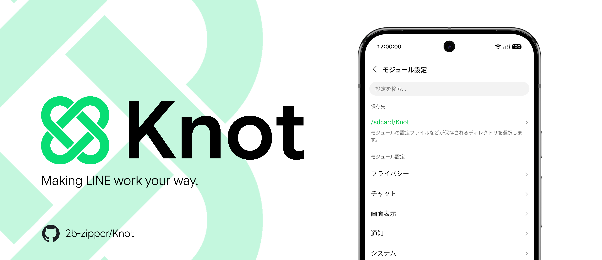
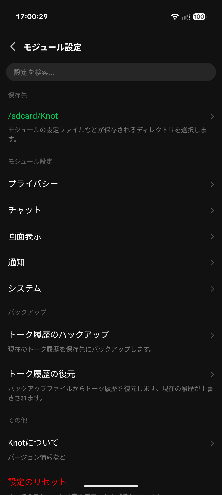
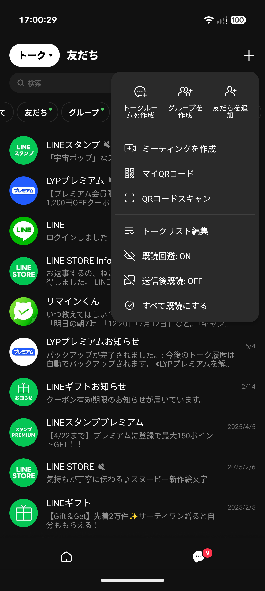
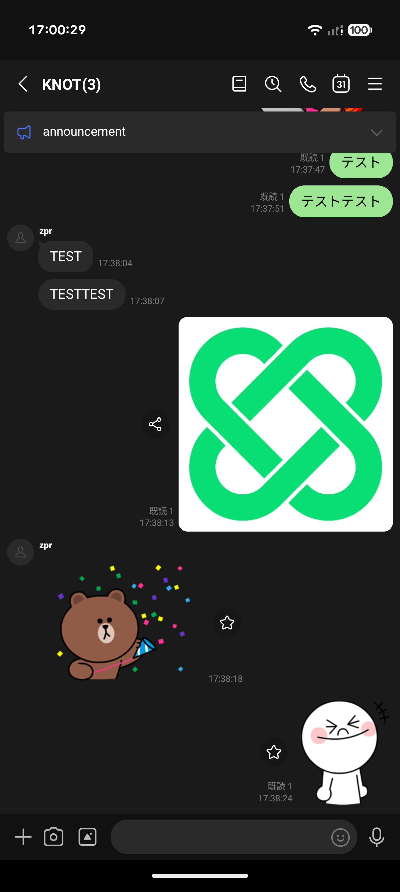
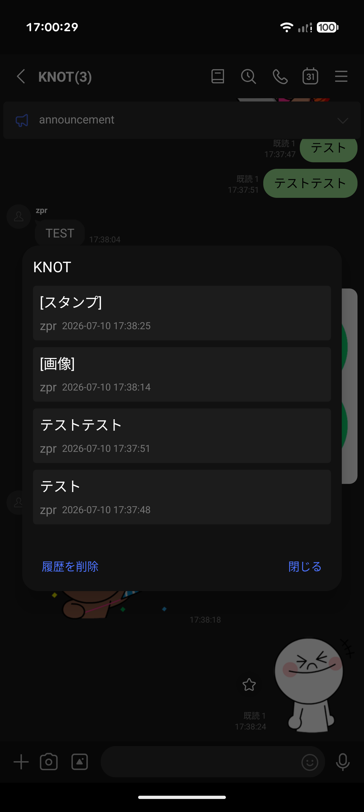
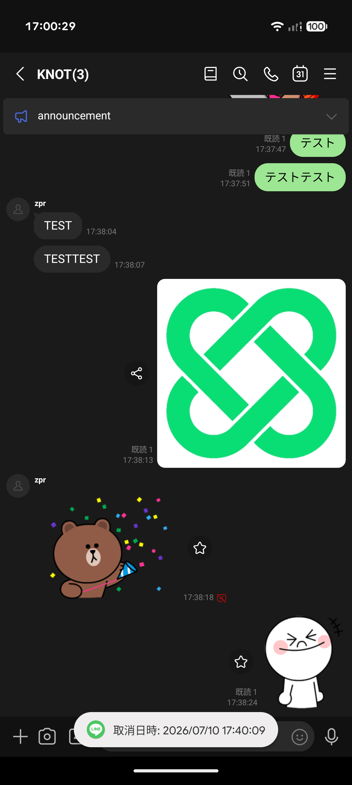
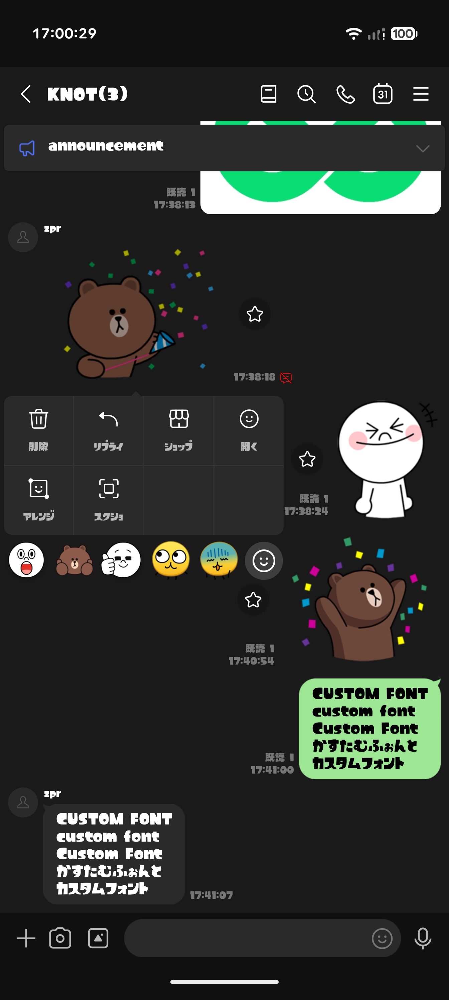

# Knot - Xposed module for LINE

**日本語** | [English](README.en.md) | [繁體中文](README.zh-Hant.md)

  
  
  
  
  

Knotは、Android版LINEのユーザー体験を向上させるために設計された開発中のXposedモジュールです。

> ⚠️このモジュールは個人が学習目的で開発したものであり、LINEヤフー株式会社とは一切関係ありません。本モジュールの使用はLINEの利用規約に抵触する可能性があり、使用に起因するアカウントの制限、凍結、データ消失などのいかなる不利益や損害についても、開発者は一切の責任を負いません。自己責任でご使用ください。

**動作確認済みLINEバージョン**: 26.13.0, 26.13.1, 26.14.0, 26.15.0, 26.15.1, 26.16.0, 26.17.0, 26.17.1
（上記以外のバージョンでも動作する可能性がありますが、一部の機能は動作しない場合があります）

**対応言語**: 日本語, English, 繁體中文

## スクリーンショット

  
  
  

  
  
  

## 主な機能

すべての機能の一覧は[knot.2ipper.com](https://knot.2ipper.com/#all-features)にあります。

### プライバシー
- **既読回避**: トークを開いても既読を付けません。「+」メニューでON/OFFでき、送信後やリアクション後に既読を付けることもできます。
- **既読履歴の記録**: 誰がいつメッセージを既読にしたかを記録します。
- **スクロールプレビュー**: LINEラボから削除され、LYPプレミアム限定になったスクロールプレビュー機能を有効化します。
- **従来の長押しメニュー**: トークリストを長押ししたときにプレビューを出さず、メニューだけを表示します。
- **編集履歴の確認**: 編集されたメッセージの編集前のテキストを記録し、長押しメニューから確認できます。
- **トークの完全非表示**: 新しいメッセージを受信しても、非表示にしたトークが再表示されないようにします。
- **送信取り消しの防止**: 相手がメッセージの送信を取り消しても、自分の端末には残るようにします。
- **24時間送信取り消し**: 送信取り消しの時間制限を1時間から24時間に戻します。
- **プロフィールの更新日時表示**: 友だち追加・お気に入り登録・プロフィール更新の日時を、友だちのプロフィール画面から確認できます。

### トーク
- **ミュートメッセージ**: LINEラボから削除され、LYPプレミアム限定になったミュートメッセージ機能を有効化します。
- **高画質写真・長尺動画送信**: 写真を自動圧縮・リサイズせずに最高品質で送り、動画送信の5分の時間制限を解除します。
- **標準カメラ・シャッター音無効化**: LINE内蔵カメラの代わりに端末の標準カメラを使うか、内蔵カメラのシャッター音を無音にできます。
- **トーク内検索の強化**: メンバーでの絞り込み検索と1文字からの検索ができ、検索キーワードアシストを検索バーのボタンで切り替えられます。
- **メッセージの秒数表示**: 各メッセージ横の時刻表示に秒を追加します（例: 12:34 → 12:34:56）。
- **編集モードでの一括全選択**: メッセージ削除画面に、すべてのメッセージを選択・選択解除できるボタンを追加します。
- **リンクをデフォルトブラウザで開く**: URLをアプリ内ブラウザではなく、システムのデフォルトブラウザで開くようにします。
- **AIアイコンの非表示**: メッセージ入力欄のAgent iを、30日間だけでなく永久に非表示にします。

### 表示・UI
- **広告の非表示**: トークリスト上部やホーム画面などに表示される広告を非表示にします。
- **ホーム画面の整理**: ホーム画面のおすすめコンテンツやフィード、サービス一覧を非表示にします。
- **タブのカスタマイズ**: 下部のニュース/通話・アプリ・ショッピング・ウォレットタブを隠せるほか、タブラベルの非表示やタップ範囲の拡大もできます。
- **トークヘッダー・メニューの整理**: トークタブ右上の「AI Friends」「オープンチャット」「カレンダー」「アルバム」ボタンと、各タブの「Agent i」ボタンを非表示にできます。
- **カスタムフォント**: 選択したフォントファイルをアプリ全体に適用します。
- **ピュアブラック (AMOLED) テーマ**: ピュアブラックテーマを適用し、メニューやダイアログも同じ配色に揃えます。
- **サブ端末でのテーマ適用**: サブ端末でログインしたときに、公式設定で非表示になる「着せかえ」項目を表示します。

### 通知・通話
- **リアクション通知**: メッセージについたリアクションを通知します。
- **通知のグループ化・スタック**: 通知を上書きせず、最大7件まで一つの通知の中にまとめて表示します。
- **通知メディアプレビュー**: 画像・動画サムネイル・スタンプ・絵文字をメッセージ通知内にプレビュー表示します。
- **通知から直接既読化**: メッセージ通知に、トークを既読にして通知を消去するボタンを追加します。
- **「通知をオフ」ボタンの非表示**: LINEの通知に表示される「通知をオフ」ボタンを削除します。
- **通知の遅延・不達対策 (FCM Fix)**: 非root環境で通知が届かない問題を回避します（非root環境では既定で有効）。
- **着信音・呼出音のカスタマイズ**: LINE通話の着信音を好きな音声ファイルに差し替えたり、発信時に相手が設定した曲ではなくデフォルトの呼出音を流したりできます。
- **通話録音の通知・アナウンス無効化**: 通話レコーディング時に相手へ送信される録音中通知や画面表示、および録音開始・終了時の音声ガイダンスを無効化します。

## インストール方法

  
  &nbsp;&nbsp;
  

### Root環境

1. [Vector](https://github.com/JingMatrix/Vector/releases)などの、API 102と互換性のあるXposed環境をインストールします。
2. [Knot](https://github.com/2b-zipper/Knot/releases/latest)をインストールし、マネージャー上でモジュールを有効化します。
3. 対象アプリとしてLINEを選択します。
4. LINEを再起動し、Knotのモジュール設定から各機能を有効化してください。
   * モジュール設定へのアクセス方法: ホームタブ右上の設定ボタンを長押しするか、LINE設定内の追加項目から開けます。

### 非Root環境
**！！！導入前に必ずトーク履歴をバックアップしてください！！！**

#### 1. 事前準備
1. [Fork版NPatch](https://github.com/Nich87/NPatch)をインストールします。
2. [MicroG-RE](https://github.com/MorpheApp/MicroG-RE)をインストールします。
3. MicroG-REを開き、`最適化を無効化`をタップして電池の最適化を無効にします。その後`セルフチェック`項目を開き、表示されている権限をすべて許可します。
4. MicroG-REの`アカウント`項目を開き、トーク履歴のバックアップに使用したGoogleアカウントでログインします。

#### 2. パッチとインストール
5. NPatchを開き、ストレージのアクセス権限と使用するディレクトリを設定します。
6. NPatchホームのリリース一覧から、最新のKnotをダウンロード・インストールします。
7. `パッチを開始`ボタンを押し、パッチ方法を選択します。
   > `プロキシからダウンロードしてパッチ`を推奨します。APKMirrorなどから自分でダウンロードする場合は、Knotの動作確認済みバージョンをダウンロードしてパッチしてください。
8. LINEのバージョン又はAPKを選択後、`新しいパッチ`画面で`MicroG対応を強制的に有効化`が有効になっていることを確認し、右下の`パッチを開始`ボタンを押してパッチを開始します。
9. パッチ完了後、右下の`インストール`ボタンを押してインストールします。
   > Shizukuがインストールされている場合は自動でインストールされます。

#### 3. 初期設定とトーク履歴の復元
10. LINEを起動してログインし、トーク履歴復元のGoogleアカウント選択画面でアカウントを選択してトーク履歴を復元します。
11. LINEホームに表示されるバナーをタップしてKnotが使用するディレクトリを設定し、ホーム右上の設定ボタンを長押ししてKnotのモジュール設定を開きます。
12. Knotのモジュール設定から各機能を有効化してください。
    * モジュール設定へのアクセス方法: ホームタブ右上の設定ボタンを長押しするか、LINE設定内の追加項目から開けます。

## リリースの種類について

<table>
  <tr>
    <td><b>Release (安定版)</b></td>
    <td>十分にテストされ、安定して動作することが確認されたバージョンです。 <b>※通常はこちらを使用してください。</b></td>
  </tr>
  <tr>
    <td><b>RC (リリース候補版)</b></td>
    <td>正式リリースに向けた最終確認のためのバージョンです。 Beta版より安定していますが、不具合が残っている可能性があります。</td>
  </tr>
  <tr>
    <td><b>Beta (ベータ版)</b></td>
    <td>新機能の追加やバグ修正のテストを目的としたバージョンです。 予期せぬ不具合が含まれる可能性があります。</td>
  </tr>
</table>

## 開発者

- [2b-zipper](https://github.com/2b-zipper)
- [Nich87](https://github.com/Nich87)

## ライセンス

このプロジェクトは[GNU GPLv3](LICENSE)の下で公開されています。

GPLv3ライセンスに基づき、このプロジェクトのコードのコピー、改変、および再配布は自由ですが、これらを利用・改変したコードを配布する場合は、**ソースコードを公開し、同じGPLv3ライセンスの下で公開する**必要があります。ソースコードを公開せずにコードを無断流用・転載して配布することは禁止されています。
