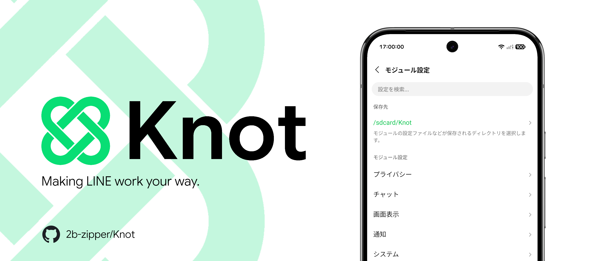
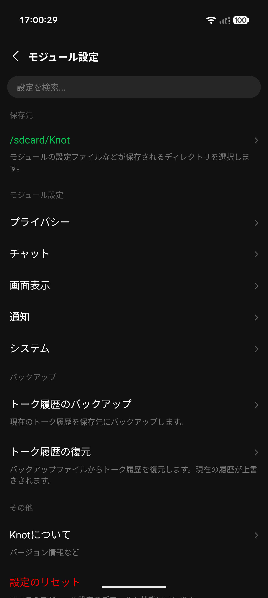
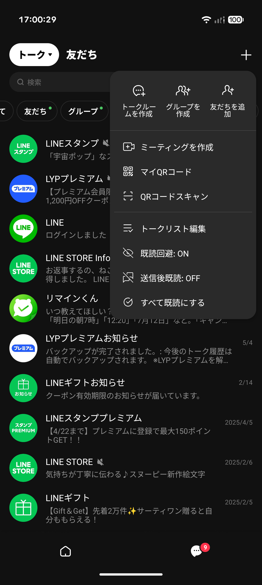
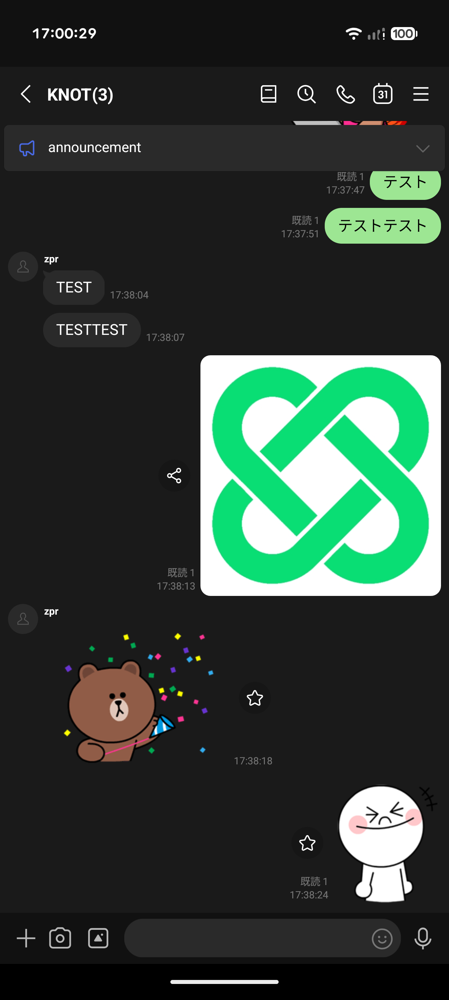
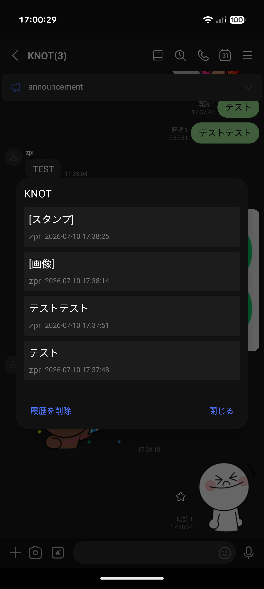
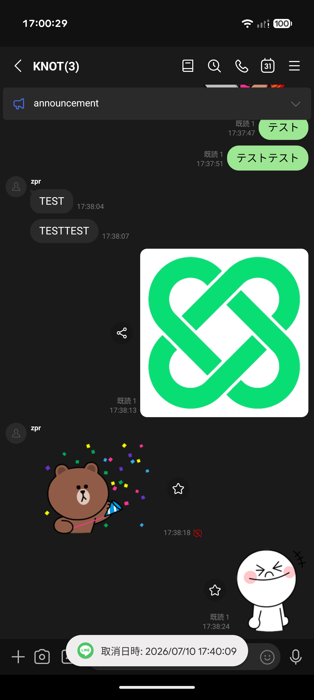
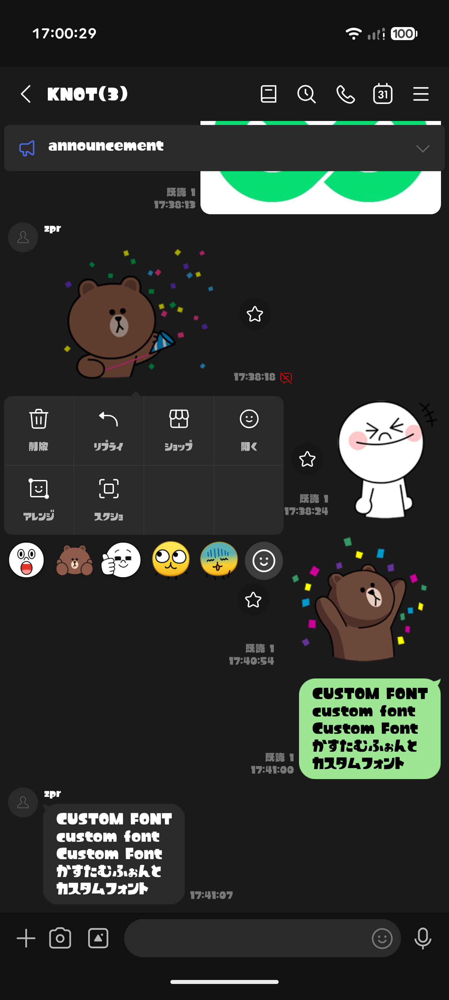

# Knot - Xposed module for LINE

[日本語](README.md) | [English](README.en.md) | **繁體中文**

  
  
  
  
  

Knot是一款開發中的Xposed模組，旨在提升Android版LINE的使用體驗。

> ⚠️本模組由個人以學習為目的所開發，與LY Corporation沒有任何關係。使用本模組可能違反LINE的服務條款，對於因使用本模組而導致的帳號受限、停權、資料遺失等任何不利影響或損害，開發者概不負責。請自行承擔使用風險。

**已驗證的LINE版本**：26.13.0, 26.13.1, 26.14.0, 26.15.0, 26.15.1, 26.16.0, 26.17.0, 26.17.1
（其他版本或許也能運作，但部分功能可能無法運作）

**支援的語言**：日本語, English, 繁體中文

## 螢幕截圖

  
  
  

  
  
  

## 主要功能

完整的功能列表請見 [Knot 網站](https://knot.2ipper.com/#all-features)。

### 隱私
- **已讀迴避**：開啟聊天室時不會標示為已讀。可從「+」選單開關，也可以在傳送訊息後或以表情貼回應後標示已讀。
- **已讀記錄**：記錄誰在何時已讀了訊息。
- **無痕預覽**：重新啟用已從LINE Labs移除、改為LYP Premium專屬的無痕預覽功能。
- **傳統長按選單**：在聊天列表長按聊天室時不顯示預覽，只顯示選單。
- **編輯記錄**：記錄訊息編輯前的文字，可從長按選單查看。
- **永久隱藏聊天**：收到新訊息時也不會重新顯示已隱藏的聊天室。
- **防收回訊息**：即使對方收回訊息，訊息仍會保留在你的裝置上。
- **24小時收回時限**：將收回訊息的時間限制從1小時恢復為24小時。
- **個人檔案更新時間**：可在好友的個人檔案畫面查看加入好友、加入我的最愛與個人檔案更新的時間。

### 聊天室
- **靜音訊息**：重新啟用已從LINE Labs移除、改為LYP Premium專屬的靜音訊息功能。
- **高品質照片與長影片傳送**：略過照片的自動壓縮與縮放，以最高品質傳送，並解除傳送影片時的5分鐘限制。
- **預設相機與靜音快門**：可使用裝置的預設相機取代LINE內建相機，或將內建相機的快門聲設為靜音。
- **強化聊天搜尋**：可依成員篩選搜尋、以1個字搜尋，並以搜尋列中的按鈕切換搜尋關鍵字輔助。
- **時間顯示秒數**：在每則訊息旁的時間顯示中加入秒數（例如12:34 → 12:34:56）。
- **編輯模式全選**：在刪除訊息畫面加入可全選或取消全選所有訊息的按鈕。
- **以預設瀏覽器開啟連結**：以系統的預設瀏覽器開啟網址，而非應用程式內建瀏覽器。
- **隱藏 AI 圖示**：永久隱藏訊息輸入欄中的Agent i，而非只隱藏30天。

### 外觀與介面
- **隱藏廣告**：隱藏顯示於聊天清單上方與主頁畫面等處的廣告。
- **精簡主頁畫面**：隱藏主頁畫面的推薦內容、動態與服務清單。
- **自訂導覽列分頁**：可隱藏下方的新聞／通話、應用程式、購物、錢包分頁，也可以隱藏分頁文字或擴大點擊範圍。
- **精簡標題列與功能選單**：隱藏聊天分頁右上角的「AI Friends」「OpenChat」「行事曆」「相簿」按鈕，以及各分頁的「Agent i」按鈕。
- **自訂字型**：將選取的字型檔套用至整個應用程式。
- **純黑（AMOLED）主題**：將深色模式背景改為純黑（#000000），選單與對話框也會套用相同的配色。
- **在子裝置套用主題**：顯示以副裝置登入時會被LINE隱藏的「主題」項目。

### 通知與通話
- **表情貼回應通知**：通知訊息收到的表情貼。
- **訊息通知堆疊分組**：不覆蓋先前的通知，最多將7則訊息合併顯示於同一則通知中。
- **通知多媒體預覽**：在訊息通知中預覽圖片、影片縮圖、貼圖與表情符號。
- **從通知直接標示為已讀**：在訊息通知中新增按鈕，可將聊天標為已讀並清除該通知。
- **隱藏「關閉通知」按鈕**：移除LINE通知中顯示的「關閉通知」按鈕。
- **改善通知延遲與遺漏（FCM Fix）**：迴避在非root環境下收不到通知的問題（非 Root 環境預設啟用）。
- **自訂來電鈴聲與答鈴**：可將LINE通話的來電鈴聲換成任意音訊檔，或在撥打電話時播放預設來電答鈴，而非對方設定的歌曲。
- **通話錄音靜音與通知停用**：在通話錄音時，停用對方的錄音中通知與畫面提示，以及錄音開始和結束時的語音提示。

## 安裝方式

  
  &nbsp;&nbsp;
  

### Root環境

1. 安裝與API 102相容的Xposed框架，例如[Vector](https://github.com/JingMatrix/Vector/releases)。
2. 安裝[Knot](https://github.com/2b-zipper/Knot/releases/latest)，並在管理器中啟用模組。
3. 將LINE設為作用域（目標應用程式）。
4. 重新啟動LINE，然後在Knot的模組設定中啟用各項功能。
   * 開啟模組設定的方法：長按主頁分頁右上角的設定按鈕，或從LINE設定中由Knot新增的項目開啟。

### 非Root環境
**！！！安裝前請務必備份聊天記錄！！！**

#### 1. 事前準備
1. 安裝[Fork版的NPatch](https://github.com/Nich87/NPatch)。
2. 安裝[MicroG-RE](https://github.com/MorpheApp/MicroG-RE)。
3. 開啟MicroG-RE，點擊`忽略最佳化`以停用電池最佳化。接著開啟`手動檢查`項目，並允許畫面上顯示的所有權限。
4. 開啟MicroG-RE的`帳戶`項目，使用備份聊天記錄時所用的Google帳戶登入。

#### 2. 修補與安裝
5. 開啟NPatch，設定儲存空間存取權限與要使用的資料夾。
6. 從NPatch主畫面的版本清單下載並安裝最新版的Knot。
7. 點擊`開始打包`按鈕，選擇修補方式。
   > 建議選擇`Download and Patch from Cloud Proxy`（從代理伺服器下載並修補）。若要自行從APKMirror等網站下載，建議下載Knot已驗證的版本再進行修補。
8. 選擇LINE的版本或APK後，在`新增打包程式`畫面確認`強制啟用 MicroG 支援`已開啟，再點擊右下角的`開始打包`按鈕開始修補。
9. 修補完成後，點擊右下角的`安裝`按鈕進行安裝。
   > 若已安裝Shizuku，將會自動安裝。

#### 3. 初始設定與還原聊天記錄
10. 啟動LINE並登入，在還原聊天記錄時選擇Google帳戶的畫面中選擇帳戶，即可還原聊天記錄。
11. 點擊LINE主頁上顯示的橫幅，設定Knot要使用的目錄；接著長按主頁右上角的設定按鈕，開啟Knot的模組設定。
12. 在Knot的模組設定中啟用各項功能。
    * 開啟模組設定的方法：長按主頁分頁右上角的設定按鈕，或從LINE設定中由Knot新增的項目開啟。

## 版本類型

<table>
  <tr>
    <td><b>Release（穩定版）</b></td>
    <td>經過充分測試，確認可穩定運作的版本。 <b>※一般情況下請使用此版本。</b></td>
  </tr>
  <tr>
    <td><b>RC（發布候選版）</b></td>
    <td>正式發布前進行最終確認用的版本。 比Beta版穩定，但仍可能殘留問題。</td>
  </tr>
  <tr>
    <td><b>Beta（測試版）</b></td>
    <td>用於測試新功能與錯誤修正的版本。 可能含有預期之外的問題。</td>
  </tr>
</table>

## 開發者

- [2b-zipper](https://github.com/2b-zipper)
- [Nich87](https://github.com/Nich87)

## 授權條款

本專案以[GNU GPLv3](LICENSE)授權公開。

依據GPLv3授權條款，你可以自由複製、修改及再散布本專案的程式碼；但若要散布使用或修改了這些程式碼的成果，**必須公開原始碼，並以相同的GPLv3授權條款公開**。禁止在未公開原始碼的情況下，擅自挪用或轉載本專案的程式碼並加以散布。
